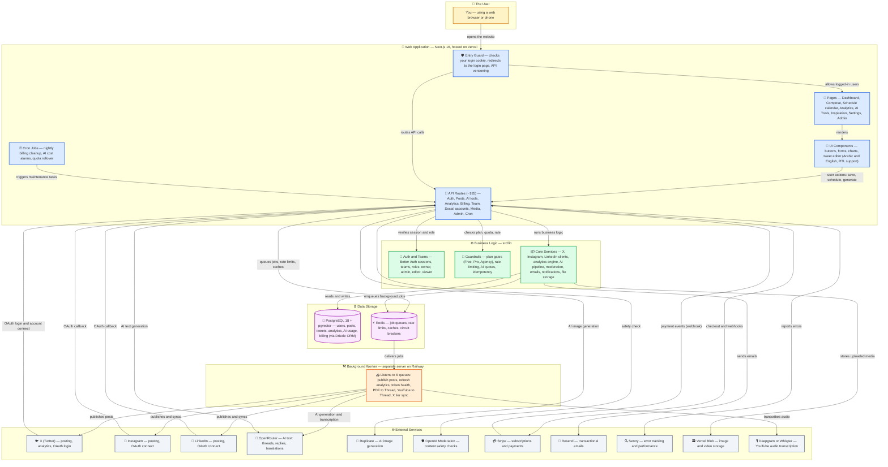
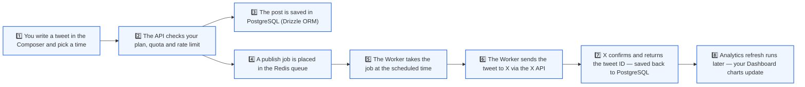

# AstraPost — Architecture Diagram

A plain-language overview of how the whole system fits together, drawn as Mermaid
diagrams so anyone — with or without coding experience — can see what talks to what.

## How to read the diagrams

- Each **box** is one part of the system. The emoji and short label say what it does.
- Each **arrow** means "data or a request flows this way".
- The **words on an arrow** say why the flow happens (for example "publishes posts").
- Boxes of the same **color** belong to the same layer:

| Color  | Layer                              | What it is                                                      |
| ------ | ---------------------------------- | --------------------------------------------------------------- |
| Blue   | Web Application                    | The website users see, running on Vercel                        |
| Green  | Business Logic                     | The brain: rules, security checks, and services                 |
| Purple | Data Storage                       | PostgreSQL database and Redis (memory)                          |
| Orange | Background Worker                  | A separate "robot" server (Railway) that does the heavy lifting |
| Gray   | External Services                  | Other companies' APIs the app talks to                          |
| Amber  | The User                           | You                                                             |

## 1. Whole system

## 2. Example journey — scheduling a tweet

Follow the numbered steps: a concrete walk-through of one user action, from clicking
"Schedule" to the tweet appearing on X.

## Key facts the diagrams are based on

- **Web app** (Vercel): Next.js 16 App Router, React 19, Tailwind CSS 4 + shadcn/ui,
  next-intl (Arabic/English). ~185 API routes, 7 cron jobs.
- **Worker** (Railway): BullMQ with 6 queues — schedule, analytics, x-tier-refresh,
  token-health, pdfThread, youtubeThread.
- **Data**: PostgreSQL 18 + pgvector via Drizzle ORM (~65 tables), Redis for queues,
  rate limits, caches and circuit breakers.
- **AI**: OpenRouter for text, Replicate for images, OpenAI Moderation for safety,
  Deepgram/Whisper for transcription.
- **Payments & comms**: Stripe (subscriptions), Resend (email), Sentry (monitoring),
  Vercel Blob (media storage).
